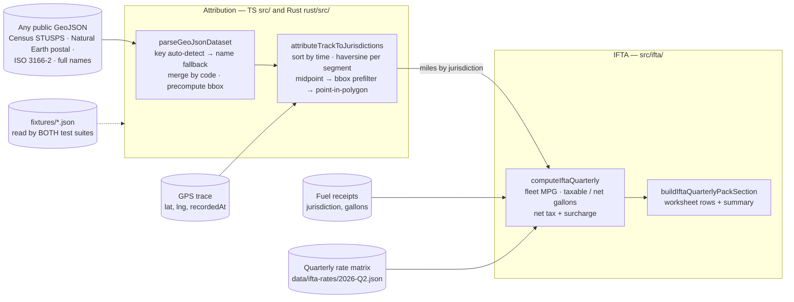

# ifta-engine

Turn a GPS trace into miles per US state / Canadian province using any public
GeoJSON, then into an IFTA quarterly fuel-tax worksheet. TypeScript and Rust,
proven identical by one shared set of fixtures.

## Why this exists

Every interstate carrier files IFTA quarterly: miles driven and fuel bought in
each jurisdiction, netted into tax due or credit per state. Most small fleets
reconstruct those miles by hand from trip sheets. This engine was extracted
from a production trucking operations platform, where the server attributes
every completed trip's GPS breadcrumbs to jurisdictions and the mobile app runs
the same algorithm offline (in Rust) so a driver sees the same numbers without
signal. Two implementations of tax math are only acceptable if something proves
they agree, so the parity fixtures are as much the product as the code.

## Architecture



**Attribution**

- **Bring your own boundaries.** `parseGeoJsonDataset` looks for a two-letter
  code under the keys real files use (`STUSPS` for Census, `postal` /
  `iso_3166_2` for Natural Earth, plus a few common variants), accepts ISO
  3166-2 (`US-GA`, `CA-ON`), and falls back to resolving a full name
  (`"Georgia"`, `"Québec"`) through a fixed lookup table. Features sharing a
  code merge into one MultiPolygon. No conversion step, no proprietary format.
- **Bounding-box prefilter.** Each jurisdiction stores its bbox at parse time,
  so most point lookups reject 60 of 64 jurisdictions with four comparisons
  before any ray-casting. Point-in-polygon honours holes.
- **Midpoint attribution.** Each consecutive pair of fixes is one segment; its
  great-circle miles go to the jurisdiction containing its midpoint. At
  typical 15–60 s sampling the error at a border is a fraction of a mile per
  crossing, and it is unbiased (half the time it favours each side). Exact
  boundary splitting is the upgrade path, deliberately not taken until the
  error matters.
- **Never silently drop miles.** Points are sorted by `recordedAt` (phones do
  deliver out of order), zero-distance duplicates are skipped, and any segment
  whose midpoint is outside every polygon — offshore, coverage gap, bad fix —
  is reported as `unattributedMiles` so the caller can flag the trip rather
  than lose distance.

**TS ↔ Rust parity**

The Rust crate is a line-for-line port (same key order, same name table, same
ray-casting, same sort). Both test suites read the same files in `fixtures/`:

- `attribution-v1.json` — hand-written synthetic squares (the original
  production fixture): a border-crossing track and an out-of-coverage track.
- `attribution-boundaries-v1.json` — generated by the TypeScript engine from the
  bundled Natural Earth file and the synthetic 1,197-mile trace: the 64
  detected codes, miles per jurisdiction, and ten probe points. Rust must match
  to `1e-6` miles.

The TypeScript engine is the reference; fixtures are regenerated from it
(`pnpm generate:fixtures`) only after an intentional change.

**IFTA math** (`src/ifta/`)

- Standard fleet-MPG method: `fleet MPG = total miles ÷ total gallons`,
  `taxable gallons = jurisdiction miles ÷ fleet MPG`,
  `net taxable = taxable − tax-paid gallons`,
  `net tax = net taxable × rate + taxable × surcharge`. Surcharges (IN, KY, VA)
  apply to every taxable gallon because pump tax does not offset them.
- **Never fabricate a dollar figure.** No rate matrix → the worksheet shows
  gallons only and drops the money columns. A jurisdiction with miles but no
  rate (Oregon uses a weight-mile tax) → `rate unavailable` and the total is
  labelled *partial*. Miles with no fuel receipts are flagged per jurisdiction.
- MPG falls back from computed → fleet override → a conservative 6.0 class-8
  default, and the worksheet says which one it used.
- Rates are a validated JSON file per quarter (`parseIftaRateFile` throws on a
  bad period, code or rate) plus an in-memory store with the production
  idempotent-upsert rule and the end-of-quarter "rates not loaded" check.

## Quick start

Requires Node 20.11+, pnpm, and (for the Rust half) a stable Rust toolchain.

```bash
pnpm install
pnpm demo          # miles per jurisdiction + IFTA worksheet for the synthetic trip
pnpm test          # TypeScript: 39 tests
pnpm test:rust     # Rust: same fixtures
pnpm demo:rust     # Rust prints the identical miles table
```

`pnpm demo` output (abridged):

```text
Boundaries: data/boundaries/us-ca-admin1.geojson (64 jurisdictions)
Trace:      data/traces/dallas-to-cincinnati.json (2465 GPS fixes)

Miles by jurisdiction
Jurisdiction     Miles  Share
AL               197.4  16.5%
KY               180.0  15.0%
LA               179.1  15.0%
TX               164.7  13.8%
GA               158.3  13.2%
MS               157.6  13.2%
TN               147.4  12.3%
OH                12.6   1.0%
(unattributed)     0.0
Total           1197.1

IFTA Quarterly Worksheet
Fleet MPG                        6.42 (computed from fuel + miles)
Estimated net tax due/(refund)   $3.70

Jurisdiction  Taxable Miles  Taxable Gallons  Tax-Paid Gallons  Net Taxable Gallons  Rate $/gal  Net Tax  Status
AL                      197             30.7                 0                 30.7       $0.31    $9.53  Missing fuel receipts
GA                      158             24.7              51.2                -26.5       $0.37   -$9.90  OK
KY                      180               28              24.8                  3.2       $0.22    $3.66  OK
...
TX                      165             25.7                62                -36.3       $0.20   -$7.27  OK
```

Use your own inputs:

```bash
pnpm demo -- --boundaries path/to/cb_2024_us_state_500k.geojson \
             --trace path/to/trace.json --fuel path/to/fuel.json \
             --rates data/ifta-rates/2026-Q3.json
```

As a library:

```ts
import {
  attributeTrackToJurisdictions, buildIftaQuarterlyPackSection,
  parseGeoJsonDataset, parseIftaRateFile, rateMapFromFile,
} from 'ifta-engine'

const dataset = parseGeoJsonDataset(geojson)            // once, cache it
const { byJurisdiction, unattributedMiles } = attributeTrackToJurisdictions(points, dataset)
const worksheet = buildIftaQuarterlyPackSection({
  miles: byJurisdiction,
  fuelRows: receipts,
  rates: rateMapFromFile(parseIftaRateFile(rateJson)),
})
```

```rust
let dataset = jurisdiction_engine::parse_geojson_dataset(&geojson)?;
let result = jurisdiction_engine::attribute_track_to_jurisdictions(&points, &dataset);
```

## Data

| Path | What | Provenance |
| --- | --- | --- |
| `data/boundaries/us-ca-admin1.geojson` | 50 states + DC + 13 provinces/territories, ~435 KB | Natural Earth 1:50m admin-1, public domain; filtered and rounded (see its README) |
| `data/traces/dallas-to-cincinnati.json` | 2,465 fixes, Dallas → I-20 → Atlanta → I-75 → Cincinnati | **Synthetic**, `scripts/generate-trace.ts` (deterministic) |
| `data/fuel/synthetic-fuel-log.json` | 4 receipts in TX, MS, GA, KY | **Synthetic** |
| `data/ifta-rates/2026-Q2.json` | Diesel rates for 47 states + IN/KY/VA surcharges | Compiled from publicly listed IFTA quarterly rates; verify against the official IFTA, Inc. matrix before filing |

## Tests

```bash
pnpm typecheck && pnpm test     # 39 TypeScript tests
cd rust && cargo test           # Rust parity tests
cargo clippy --all-targets -- -D warnings
```

- `tests/attribute.test.ts` (from production) — point lookup, haversine,
  border-crossing split, out-of-order points, unattributed miles, zero-distance
  fixes, GeoJSON key/name/ISO detection, MultiPolygon merge, and a bbox
  regression.
- `tests/parity-fixtures.test.ts` + `rust/tests/fixtures.rs` +
  `rust/tests/real_world.rs` — both languages against the same fixture files,
  including the real-boundary trace pinned to `1e-6` miles.
- `tests/ifta.test.ts` (new) — hand-computed worksheet (tax due, credit,
  surcharge on taxable gallons), MPG fallbacks, incomplete-receipt flags,
  no-rate and partial-rate behaviour, code normalisation, the rendered report
  section, rate-file validation, idempotent upsert, UTC quarter math and the
  reminder window.

## What was left out

The server and mobile glue: the database tables and queries that collect
breadcrumbs, fuel receipts and fleet settings per tenant, the scheduled job and
email that nag ops when a quarter's rates are missing (only the pure check
remains), the CSV/PDF serializers, the IFTA audit-packet sections, auth and
role checks, and the FFI bindings that expose the Rust crate to iOS/Android.

## License

MIT. Boundary data: Natural Earth, public domain.
